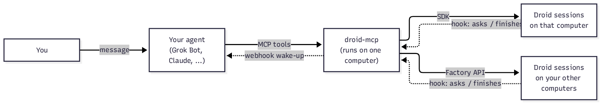

# droid-mcp

You message your agent. Your agent drives Factory Droid for you, on any of your computers.



droid-mcp is an MCP server. It runs on one computer. Your agent (Grok Bot, Claude, Cursor or any MCP client) connects to it.

## Your agent can

- Start a Droid session in a repo on the computer that runs droid-mcp, with the model and autonomy you pick.
- See every session on every online computer. A session droid-mcp runs is Working, Needs you, Idle, Dead or Closed. Others show Working or Idle.
- Get woken when a session it is subscribed to asks a question, needs permission, finishes or ends. You choose the subscriptions.
- Answer the question, approve or deny the permission, or send a follow-up.
- Read the result and the git diff.
- Interrupt a turn or close a session.
- Watch the sessions you run yourself and step in when you ask it to.
- Search and run rare operations with `droid_ops` and `droid_call`. Destructive ones need your OK.

## What to set up

Each piece unlocks more. Start with the first two.

1. **Droid CLI, logged in, on the computer that runs droid-mcp.** Unlocks sessions on that computer.
2. **droid-mcp connected to your agent.** Over stdio, or over HTTP with `DROID_MCP_TOKEN`. Unlocks every tool.
3. **`DROID_MCP_ROOTS`.** The folders sessions may start in. Defaults to `~/repos`.
4. **`FACTORY_API_KEY`.** Unlocks your other computers and sending to sessions droid-mcp did not start.
5. **HTTP mode and the droid-mcp plugin on each computer.** Unlocks wake-ups from that computer. Tell your agent "set up droid-mcp on my laptop". It installs the plugin through a Droid session there. No tokens are copied anywhere.
6. **`DROID_MCP_WEBHOOK_URL` and `DROID_MCP_WEBHOOK_KEY`.** Unlocks wake-ups pushed to your agent instead of polled.

To install the plugin by hand on one computer instead:

```sh
droid plugin marketplace add Jason-Holt-Digital/droid-mcp
droid plugin install droid-mcp@droid-mcp --scope user
```

Then write `~/.factory/droid-mcp.curlrc`. The `droid_status` tool prints the full line for each computer.

## Install

```sh
git clone https://github.com/Jason-Holt-Digital/droid-mcp
cd droid-mcp && npm ci
node src/main.ts doctor
```

Then add it to your agent:

```json
{ "mcpServers": { "droid": { "command": "node", "args": ["/path/to/droid-mcp/src/main.ts"] } } }
```

Or let your agent do it. Point it at `skills/droid-mcp/SKILL.md` and say "set up droid-mcp".

## Safety

- Sessions start only inside `DROID_MCP_ROOTS`.
- `DROID_MCP_MAX_AUTONOMY` caps autonomy. Permission answers above the cap, and "always allow" answers, are never offered.
- Every tool says whether it reads, writes or destroys.
- The plugin holds no secret. It only rings droid-mcp, which checks each ring against Factory or its own session before waking anyone.
- droid-mcp never puts `FACTORY_API_KEY` or its tokens in a result. Sessions it starts do get the API key in their environment.

## More

- [Session states](docs/states.md), with the state chart.
- [Wake-ups and the plugin](docs/wake-ups.md).
- [Running as a service on macOS, Linux and Windows](docs/service.md).
- [Every tool and its errors](docs/tools.md).
- [Development](docs/development.md).

MIT licensed. See [LICENSE](LICENSE).
