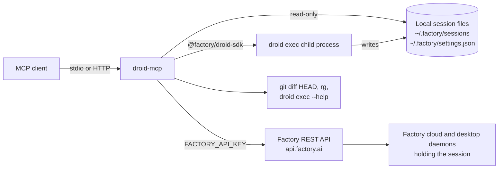

# droid-mcp

An MCP server that lets any MCP client (Droid, Claude Code, Cursor, other agents) find, start, steer and read Factory Droid sessions, including mission/workstream orchestrators and their agents. It reads local session files, runs its own sessions through `@factory/droid-sdk`, and reaches sessions held elsewhere through the Factory REST API when an API key is available.

Status: early (0.1.0). Tested on macOS with droid CLI 1.10.0, `@factory/droid-sdk` 0.11.0 and Node 26 (`engines` requires Node >= 24). The only platform-specific code is the Keychain lookup for `FACTORY_API_KEY`, which runs only on `darwin`; elsewhere the key must come from the environment. Linux is untested.

## How the tools fit together

```text
Discover            Start or steer          Follow and approve                        Read or stop
droid_find    ─┐    droid_start ─┐          droid_wait ── pending prompt? ──► droid_respond
droid_models  ─┴──► droid_send  ─┴─► turn ─► droid_wait ── state "idle" ─────► droid_result
                                     runs in                                   droid_cancel
                                     background
```

Terms used below:

- **Workstream (mission):** a multi-agent Factory session: one **orchestrator** plus child **agent** sessions, tagged `mission-v2`.
- **Own session:** a session currently running inside this server, either started with `droid_start` or resumed locally by `droid_send`. It stays own until it is closed.
- **Autonomy:** what the agent in a session may do without asking: `off` < `low` < `medium` < `high`.
- **Pending prompt:** a permission request or AskUser question waiting for `droid_respond` (listed in `attention`).

## Access at a glance

Three backends, and the credential each needs:

| Backend | What it is | Credential |
| --- | --- | --- |
| Local files | `~/.factory/sessions` (transcripts and settings), `~/.factory/settings.json`, read directly | None |
| `droid exec` child process | A droid session the server spawns through `@factory/droid-sdk` | `FACTORY_API_KEY` if one is found, otherwise the droid CLI login |
| Factory REST API | `https://api.factory.ai`, reaches sessions held by the desktop app, other machines and the cloud | `FACTORY_API_KEY` |

Helpers: `git diff HEAD` (diffs), `rg` (transcript search), `droid exec --help` (model list).

What each tool can do:

| Tool | Reads | Can change | Backend | Credential | Cost/side effects |
| --- | --- | --- | --- | --- | --- |
| `droid_find` (read-only) | Session headers and settings; transcripts when `content: true`; child sessions of listed workstreams when a key is set | Nothing | Local files (`~/.factory/sessions`), `rg`, Factory REST API (optional) | None; `FACTORY_API_KEY` for the child-session summary | No model tokens |
| `droid_models` (read-only) | Built-in models, aliases and wildcards; `customModels` in settings | Nothing | `droid exec --help` (cached 60 s), `~/.factory/settings.json` | None | No model tokens |
| `droid_start` | Model list, `~/.droid-mcp/state.json`, the fork source (with `fork`) | Creates a session; the agent edits files in `cwd` up to the granted autonomy | `droid exec` child process spawned through the SDK | `FACTORY_API_KEY` if found, otherwise the droid CLI login | Spends model tokens; writes `~/.droid-mcp/state.json` |
| `droid_send` | Target session settings, model list, `~/.droid-mcp/state.json` | Sends a prompt as the user; changes model, tools and autonomy; may resume a local session | Own child process, Factory REST API, or a new `droid exec` (local resume) | Own session's existing connection; `FACTORY_API_KEY` for REST; CLI login for local resume (only reachable without a key) | Spends model tokens; writes `~/.droid-mcp/state.json` |
| `droid_wait` (read-only) | New events, local transcript messages (user and assistant text only), or REST messages and pending prompts | Nothing | In-memory event log, local transcript, Factory REST API | None for local; `FACTORY_API_KEY` for REST | No model tokens; polls every 1 s (local file) or 2 s (REST) |
| `droid_respond` | Pending prompts | Answers or cancels a permission prompt or AskUser question | Own child process or Factory REST API | None for own sessions; `FACTORY_API_KEY` otherwise | Lets a paused turn continue, which spends tokens |
| `droid_cancel` | None | Interrupts a turn; closes an own session | Own child process or Factory REST API | None for own sessions; `FACTORY_API_KEY` otherwise (`scope: "turn"` only) | Stops token spend |
| `droid_result` (read-only) | Latest result text; `git diff HEAD` in the session's cwd | Nothing | In-memory result, local transcript, Factory REST API, `git` | None for local; `FACTORY_API_KEY` for sessions not on this machine | No model tokens |

"Read-only" means the tool is registered with `readOnlyHint: true` (`src/tools.ts`).

Which backend a call uses depends on the target session (`src/route.ts`, `src/tools.ts`):

| Target | `droid_send` | `droid_wait` | `droid_result` | `droid_respond`, `droid_cancel` |
| --- | --- | --- | --- | --- |
| Own session | Child process | In-memory events (`seq` = event number) | Last result; `git diff HEAD` | Child process; `droid_cancel` can close it |
| Local standalone session | With a key: REST. Without: local resume (below) | Local transcript (`seq` = byte offset, no pending prompts) | Local transcript; `git diff HEAD` | REST (needs key); `droid_cancel` turn only |
| Local workstream session | REST (needs key); never resumed locally | With a key: REST (`seq` = message number). Without: local transcript | Local transcript; `git diff HEAD` | REST (needs key); `droid_cancel` turn only |
| Not on this machine | REST (needs key) | REST (needs key) | REST text; no diff | REST (needs key); `droid_cancel` turn only |

Local resume happens only without a key, only with `allowLocalResume: true`, and only for a standalone session that has readable settings, is not archived, is not a subagent, was not modified in the last 30 minutes, and has a recorded autonomy within the cap. The resumed session becomes an own session.

## What the agent can and cannot touch

### Filesystem

- `droid_start`, local resume and `droid_result` diffs require a `cwd` inside `DROID_MCP_ROOTS` (colon-separated, default `~/repos`). Both the cwd and each root go through `realpath`, so symlinks are resolved before the prefix check, and a missing cwd is refused (`src/config.ts`).
- `DROID_MCP_ROOTS` limits where the server starts or diffs work. It is not a read sandbox:

  | Operation | Limited to `DROID_MCP_ROOTS`? |
  | --- | --- |
  | `droid_start` cwd, local resume, `droid_result` diff | Yes |
  | `droid_start` fork source (the source's own cwd) | No |
  | `droid_find`, `droid_wait`, `droid_result` text (any local transcript) | No |
  | REST sends, `droid_respond`, `droid_cancel` (any session the key can reach) | No |

- Files read: `~/.factory/sessions/*/*.jsonl` and their `.settings.json` files (`src/catalog.ts`), `~/.factory/settings.json` (`src/models.ts`), and `~/.droid-mcp/state.json` (`src/runs.ts`).
- The only file the server writes is `~/.droid-mcp/state.json`, through a temporary file in the same directory and a rename. The directory is created with mode `0700` and the file with `0600` (`src/runs.ts`).
- Droid writes its own session files. The agent inside a session starts in its cwd, but autonomy, not the roots list, decides what its commands can touch.

### Autonomy

- Levels are `off`, `low`, `medium`, `high`. A start without `autonomy` uses `off` (`src/config.ts`).
- `DROID_MCP_MAX_AUTONOMY` sets the cap (default `high`). An unrecognized value sets the cap to `off`. Requests above the cap are refused (`src/config.ts`).
- A local resume refuses a session whose recorded autonomy is above the cap, and checks again after loading it (`src/route.ts`, `src/runs.ts`). A fork does not check the source's autonomy; the fork gets the requested autonomy (default `off`).
- Over REST, the requested autonomy is capped, but the session's existing autonomy is not read or checked (`src/tools.ts`).
- Permission prompt answers are filtered by `allowedDecisions`: `proceed_always*`, `proceed_edit`, `proceed_auto_run` and `proceed_new_session` are never offered, and `proceed_auto_run_<level>` / `proceed_new_session_<level>` only when the level is within the cap. This applies to own sessions and REST answers (`src/config.ts`, `src/runs.ts`, `src/tools.ts`).
- No parameter maps to `--skip-permissions-unsafe`. The only extra `droid exec` argument the server adds is `--worktree [branch]` (`src/runs.ts`).

### Models and settings

`droid_start` and `droid_send` share these optional settings: `model`, `reasoningEffort`, `specModel`, `specReasoningEffort`, `useSpec`, `mission`, `workerModel`, `workerReasoningEffort`, `validatorModel`, `validatorReasoningEffort`, `tags`, `worktree`, `onlyTools`, `addTools`, `removeTools`, `appendSystemPrompt`, `fork`.

Validation, before anything runs (`src/settings.ts`, `src/models.ts`):

- Every model id must be a built-in id, a custom id from `~/.factory/settings.json`, a tier alias or a version wildcard. Unknown ids are refused with up to five close matches.
- An effort is checked against the model's supported list when that model is given (`specReasoningEffort` against `specModel`, falling back to `model`).
- Worker and validator settings require `mission: true`; `mission` cannot be combined with `useSpec`; `mission` requires autonomy `high` (the requested autonomy, or the session's current one for own and local sessions).

Where each setting is applied:

| Setting | New session | Fork | Own session send / local resume | REST send |
| --- | --- | --- | --- | --- |
| `model`, efforts, `specModel`, `useSpec: true`, tool lists | `updateSettings` before the first prompt | Same | `updateSettings` before the prompt | `updateSession` before the prompt |
| `mission: true`, worker and validator settings | `updateSettings` | Same | `updateSettings` | Ignored (still validated, so `mission` needs `autonomy: "high"` in the same call) |
| `autonomy` | At session creation | `updateSettings` | `updateSettings` | `updateSession` |
| `tags` | At creation, plus `droid-mcp` | On the fork, plus `droid-mcp` | Added to the session's tags, keeping existing tag metadata | Ignored |
| `worktree` | `--worktree [branch]` | Same | Ignored | Ignored |
| `appendSystemPrompt` | Appended to the `droid` preset | Refused | Ignored | Ignored |
| `fork` | Loads the source locally and forks it. Only checks that the source is on disk and not open in this server; the local-resume guards above do not apply | n/a | Ignored | Ignored |

Ignored settings come back in the `ignored` field of the `droid_send` result; REST sends also return `applied` (`src/tools.ts`, `src/settings.ts`). `useSpec: false` and `mission: false` do nothing: neither switches a session back to normal mode.

### Concurrency limits

- At most 3 turns running or waiting on a prompt at once, and one per repo. The repo is the nearest ancestor of the cwd that contains `.git` (`src/runs.ts`, `src/catalog.ts`).
- A pending permission or AskUser prompt is cancelled after 30 minutes (`src/runs.ts`).
- `mode: "interrupt"` waits up to 15 s for the running turn to stop; if it does not, nothing is sent (`src/runs.ts`).
- Each own session keeps its last 1000 events; `droid_wait` sets `gap: true` when older events were dropped (`src/runs.ts`).

### Idempotency keys

`droid_start` and `droid_send` require an `idempotencyKey` (1 to 200 characters). Keys are stored in `~/.droid-mcp/state.json` for 7 days (`src/runs.ts`):

- A retry with a finished key returns the first result without running again. For `droid_start` the session state in the reply is current.
- A key is marked pending before the action runs. If the action was refused before any side effect, the key is dropped and can be reused. If it failed after it may have taken effect, the key stays pending and a retry is refused.
- Each save merges with the file on disk, so several server processes can share it.

### HTTP mode

- `--http <host:port>` requires `DROID_MCP_TOKEN`. Every request must send `Authorization: Bearer <token>`, compared with `timingSafeEqual` (`src/main.ts`).
- Any request with an `Origin` header is rejected with 403, so browsers cannot call the server (`src/main.ts`).
- `DROID_MCP_TOKEN` is deleted from the process environment at startup, so spawned sessions do not inherit it (`src/main.ts`).
- Each request gets a fresh, stateless MCP server; sessions and runs are shared across requests (`src/main.ts`).

### What it never does

- Never returns `FACTORY_API_KEY` or custom-model API keys. Custom models are reduced to an allowlist of fields, and `baseUrl` is reduced to its host (`src/models.ts`).
- Never offers "always allow" permission options (`src/config.ts`).
- Never closes a session that is not an own session; `droid_cancel` with `scope: "session"` is refused for those (`src/tools.ts`).
- Never resumes a workstream session, or one whose settings it cannot read, through `droid_send` (`src/route.ts`). `droid_start` with `fork` does load its source locally without these checks.
- Never runs commands other than `droid exec` (through the SDK), `droid exec --help`, `git -C <cwd> diff HEAD`, `rg` and, on macOS, `security find-generic-password` (`src/models.ts`, `src/tools.ts`, `src/catalog.ts`, `src/config.ts`).
- Has no tool that deletes sessions or files (`src/tools.ts`).

## How it works



Sessions this server starts live in memory. When the stdio client disconnects, or the process gets SIGINT or SIGTERM, the server closes all of them. After a restart they are ordinary local sessions.

## Setup

Requirements: Node >= 24, the `droid` CLI (logged in, or `FACTORY_API_KEY`), `git` and `rg` on the `PATH` the MCP client gives the server. Many clients start servers with a minimal `PATH`; pass one explicitly if `droid` or `rg` is not found.

```sh
cd /path/to/droid-mcp
npm install
```

Droid:

```sh
droid mcp add droid-mcp node /path/to/droid-mcp/src/main.ts --env PATH=/path/to/bin:/usr/bin:/bin
```

Claude Code:

```sh
claude mcp add droid-mcp -e PATH=/path/to/bin:/usr/bin:/bin -- node /path/to/droid-mcp/src/main.ts
```

Cursor (`~/.cursor/mcp.json`):

```json
{
  "mcpServers": {
    "droid-mcp": {
      "command": "node",
      "args": ["/path/to/droid-mcp/src/main.ts"],
      "env": { "PATH": "/path/to/bin:/usr/bin:/bin" }
    }
  }
}
```

### HTTP mode

```sh
DROID_MCP_TOKEN=<token> node src/main.ts --http 127.0.0.1:37999
```

Use `http://127.0.0.1:37999/mcp` as the endpoint (the server answers on any path) with the header `Authorization: Bearer <token>`:

```sh
droid mcp add droid-mcp http://127.0.0.1:37999/mcp --type http --header "Authorization: Bearer <token>"
claude mcp add --transport http droid-mcp http://127.0.0.1:37999/mcp -H "Authorization: Bearer <token>"
```

To reach it from other machines on a tailnet, put it behind `tailscale serve`:

```sh
tailscale serve --bg --https=8443 http://127.0.0.1:37999
```

The endpoint is then `https://<your-host>.<tailnet>.ts.net:8443/mcp`. The bearer token is still required.

## Configuration

| Variable | Default | Effect |
| --- | --- | --- |
| `FACTORY_API_KEY` | unset | Enables the REST backend, and is used for spawned sessions instead of the CLI login |
| `DROID_MCP_ROOTS` | `~/repos` | Colon-separated directories a session cwd must resolve inside |
| `DROID_MCP_MAX_AUTONOMY` | `high` | Autonomy cap: `off`, `low`, `medium`, `high`; any other value means `off` |
| `DROID_MCP_TOKEN` | unset | Bearer token; required with `--http` |

On macOS, when `FACTORY_API_KEY` is not set, the server looks for it in the Keychain:

```sh
security add-generic-password -s droid-mcp -a FACTORY_API_KEY -w   # prompts for the key
```

The key is read once at startup; restart the server after changing it.

## Tool reference

All results are JSON text, trimmed to about 8 KB; event text is clipped at 4000 characters with `truncated: true`.

| Tool | Key parameters | Notes |
| --- | --- | --- |
| `droid_find` | `query`, `content`, `scope` (`workstreams`, `sessions`, `all`), `cwd`, `includeArchived`, `includeSubagents`, `limit` (1-200, default 40), `cursor` | Groups workstreams (orchestrator first, then agents) and standalone sessions by repo. `query` matches title, id prefix or cwd; with `content: true` it searches transcripts with `rg -F` (40 s timeout). Hidden by default: archived sessions and subagents. With a key, each listed workstream gets a `children` summary from REST, including agents on other machines. |
| `droid_models` | `filter`, `include` (`builtin`, `custom`, `aliases`) | Built-in ids with supported efforts, custom models, tier aliases, version wildcards and the default model. |
| `droid_start` | `cwd`, `prompt`, `idempotencyKey` (required), `autonomy`, settings | Returns `sessionId` and `state`. The turn runs in the background; follow it with `droid_wait`. |
| `droid_send` | `session`, `prompt`, `idempotencyKey` (required), `mode` (`queue`, `interrupt`), `allowLocalResume`, `autonomy`, settings | Returns `via` (`own`, `local-resume`, `rest`), `nextSeq` for own and resumed sessions, `messageId` for REST. `queue` is refused while a turn is running. |
| `droid_wait` | `session`, `afterSeq`, `waitMs` (default 25000, max 50000), `maxEvents` (1-200, default 50) | Without `afterSeq`, returns the latest events at once. With it, waits for an assistant message, prompt, error or state change. `attention` lists pending prompts with their `requestId` (`null` for local transcript reads). |
| `droid_respond` | `session`, `requestId`, `decision` and `comment`, or `answers` (one per question), or `cancel` | `decision` must be one of the offered options. |
| `droid_cancel` | `session`, `scope` (`turn`, `session`) | `session` only for own sessions. |
| `droid_result` | `session`, `include` (`text`, `diff`), `offset`, `maxBytes` (1-32768, default 6000) | Paged by byte offset; pass `nextOffset` back as `offset`. |

`seq` is a cursor whose meaning depends on the source: an event number for sessions this server runs, a byte offset into the transcript for other local sessions, and a message sequence number for REST sessions. Treat it as opaque and pass `nextSeq` back as `afterSeq`.

## Development

```sh
npm run typecheck   # tsc --noEmit
npm test            # node --test "test/*.test.ts"
node scripts/smoke.ts [scratchDir] [idleSessionIdToResume]
```

`scripts/smoke.ts` is a live end-to-end check over a real stdio MCP client. It spends model tokens. It starts the server with `DROID_MCP_MAX_AUTONOMY=medium` and `FACTORY_API_KEY` removed from its environment, then:

- checks the tool list, `droid_find` grouping, title and content search, and read-only `droid_wait`/`droid_result` on a local orchestrator;
- checks refusals: sending to a workstream without a key, an unknown session, a cwd outside the roots, autonomy above the cap;
- starts a session in the scratch dir (default `~/repos/droid-mcp-scratch`, which must be inside `DROID_MCP_ROOTS`) at autonomy `off`, approves its permission prompt, and checks the created file, the result text, idempotent start and send, the diff and closing;
- with a second argument, resumes that idle local session with `allowLocalResume`.

It needs at least one local workstream session with its orchestrator, and a transcript containing the text `droid_find`. It refuses to run when a key is in the Keychain: the refusal checks send to a real workstream, and with a key those sends would go through REST and actually post.

## Known limits

- REST settings updates (`updateSession`) are not verified against the live API.
- Sessions started with `worktree` run in a worktree outside the allowed roots, so `droid_result` refuses their diffs.
- A fork keeps its source session loaded until the fork is closed.
- Mission mode is untested live.
- REST `droid_wait` assumes `getMessages` returns the newest messages (see the comment in `src/tools.ts`).
- Sessions on other machines are reachable by REST, but `droid_find` lists only local session files (plus the REST child summary for local workstreams).
- `droid_wait` on a local transcript cannot see pending prompts or tool events.
- After an own session is closed, `droid_wait` and `droid_result` keep reading its in-memory state. If a later `droid_send` reaches it over REST, they do not see the new turn.
- Linux is untested.

## Security notes

- Treat `DROID_MCP_TOKEN` like a password: it grants every tool, including starting sessions.
- Autonomy `high` lets droid run arbitrary commands, starting from a cwd inside the allowed roots but not confined to it. Lower `DROID_MCP_MAX_AUTONOMY` if clients should not be able to grant it.
- REST sends act as the owner of `FACTORY_API_KEY`, on any session that key can reach.
- Prompts are sent as the user; the session sees them as the user's own messages.
- When a key is found, the SDK passes it to spawned `droid exec` processes as `FACTORY_API_KEY`, so commands an agent runs in those sessions can read it.

## License

MIT. See [LICENSE](LICENSE).
