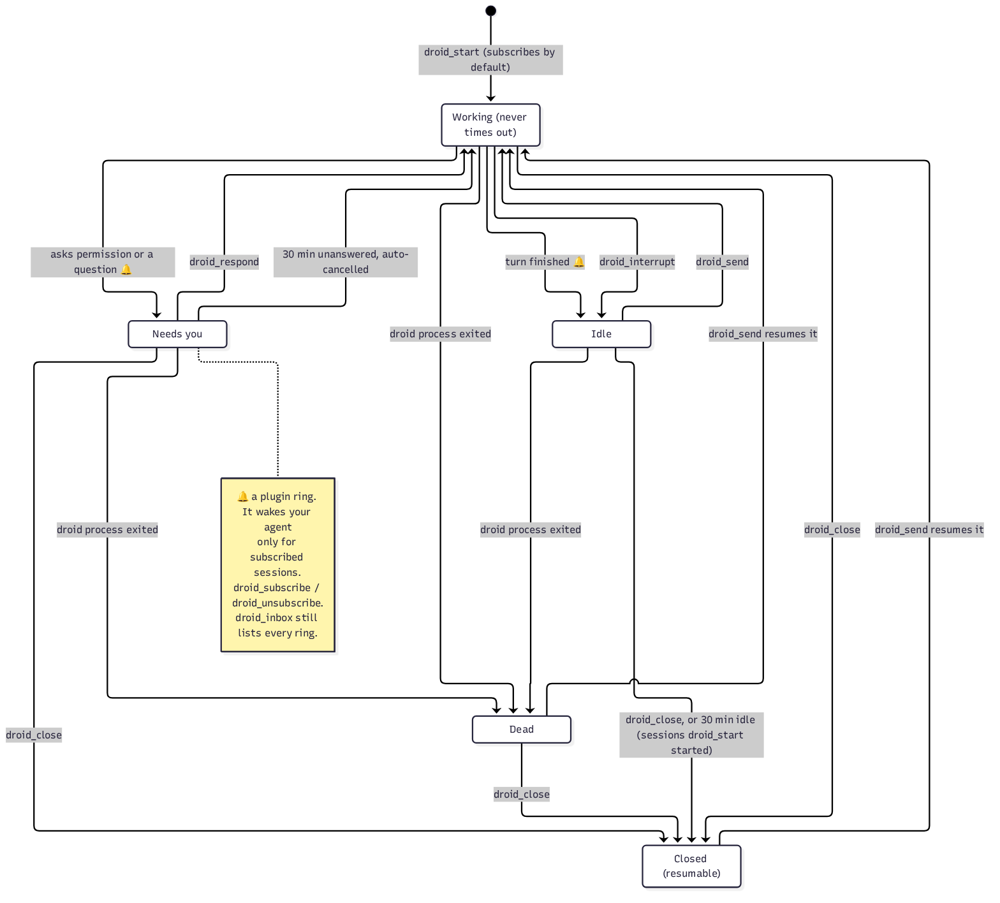

# Session states

Every session in `droid_sessions` has one `state`. Sessions that droid-mcp runs itself can be in any of the five states below. A session droid-mcp does not run (your own sessions, or sessions on other computers) shows only `working` or `idle`: Factory's status `running` or `pending` maps to `working`, and anything else to `idle`. Factory does not report waiting prompts in that status, so those sessions never show `needs_you`. Use `droid_wait` on them to see pending prompts in `attention`. The exception is a standalone session you run on the server computer: droid-mcp reads it from its transcript, so `attention` is always `null` and its prompts can only be answered in your own Droid window.

The rest of this page describes sessions droid-mcp runs: sessions started with `droid_start`, and local sessions that `droid_send` resumed in a new droid process. The code is `src/runs.ts`.

## States

- **Working.** A turn is running. droid-mcp never times out a working turn.
- **Needs you.** The turn is paused on a permission prompt or an AskUser question. `droid_wait` lists it in `attention` with its `requestId`.
- **Idle.** The turn ended and the droid process is still alive.
- **Dead.** The droid process exited, or its connection ended, without droid-mcp closing it. Pending prompts are cancelled.
- **Closed.** droid-mcp stopped the process. The session stays on disk and can be resumed.

## Transitions

- `droid_start` creates the session and sends the first prompt, so it starts in **Working**. It subscribes you to the session unless you pass `subscribe: false`.
- A permission prompt or AskUser question moves **Working** to **Needs you**.
- `droid_respond` answers or cancels the prompt. When no prompt is left, the session is **Working** again.
- A prompt nobody answers for 30 minutes is cancelled, and the session goes back to **Working**.
- When the turn ends, the session is **Idle**. `droid_interrupt` stops the turn, which also ends in **Idle**. Interrupting a session that **Needs you** cancels its prompts first.
- `droid_send` on an **Idle** session starts a new turn. With `mode: "queue"` (the default) it is refused as `busy` while a turn is running; `mode: "interrupt"` stops the turn first.
- If the droid process exits, the session is **Dead**, from any state but Closed. The next `droid_send` resumes it in a new process under the same session id and starts the turn.
- `droid_close` moves any state to **Closed**. droid-mcp also closes every session it runs when it shuts down (SIGINT, SIGTERM, or the stdio client disconnecting).
- A session started with `droid_start` closes itself after 30 minutes in **Idle**. The timer starts when a turn ends and stops on the next send, a close, or the process dying. It never runs during a turn, and it never runs in **Dead**. Sessions that `droid_send` resumed from your own local sessions never auto-close.
- `droid_send` on a **Closed** session resumes it in a new process. If nothing touched the transcript since droid-mcp closed it, the 30-minute check for local sessions is skipped. Without `FACTORY_API_KEY` it still needs `allowLocalResume: true`. droid-mcp remembers closed sessions in memory only; after a restart they are ordinary local sessions.

## Wake-ups

The 🔔 marks the transitions where the doorbell plugin rings droid-mcp:

- A permission prompt rings `permission`. An AskUser question rings `question`.
- A finished turn rings `finished`, or `question` when the last reply has a line starting `QUESTION:`.
- A session that ends rings `ended`, from Droid's `SessionEnd` hook.

A ring wakes your agent only when the session is subscribed and the webhook is set. A cancelled prompt does not ring. Whether a droid process that crashes still rings `ended` depends on Droid running its `SessionEnd` hook; that is unverified. See [Wake-ups](wake-ups.md).
